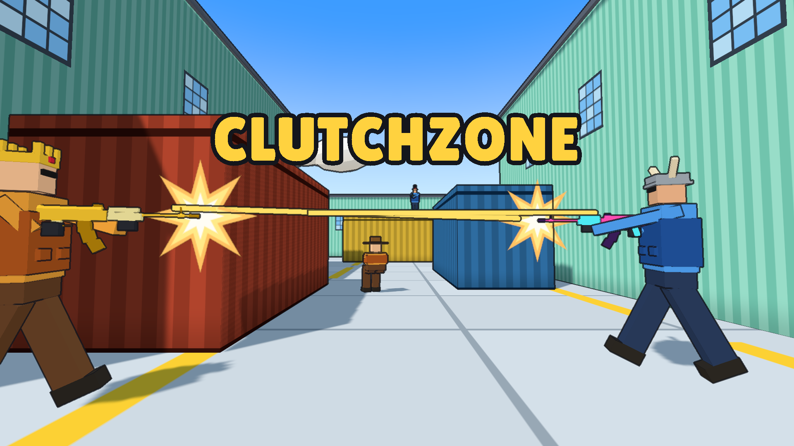

# Clutchzone



A browser shooter I've been building since October. Think a small, cartoony Counter-Strike: 4v4,
attackers plant the bomb on A or B, defenders try to stop them. When there aren't enough people
online, bots take the empty slots, so you never sit in an empty lobby.

**Play it:** https://clutchzone.pro (also on [itch.io](https://tymek8191-tech.itch.io/clutchzone), with a Windows build)

What's in right now:

- 3 maps: Plaza, Reactor, Skyline
- 6 weapons: rifle, pistol, sniper, SMG, shotgun and a knife
- first to 7 rounds, sides swap at half time
- XP and levels, skins / hats / kill effects to unlock, daily challenges
- private rooms with an invite link

## How it works

The client is three.js + TypeScript (Vite). The server is plain Node with `ws` and it has the final
say: it runs every room at 60 ticks per second and sends snapshots 30 times a second. Client and
server share the same `simulate()` function, so the client can predict your movement right away and
correct itself when the server answers. Hits are lag-compensated, the server rewinds the other
players to where you saw them when you pulled the trigger.

It all runs in a Docker container on one small Fly.io machine in Frankfurt. The domain is on OVH,
DNS points at Fly, and the certificate comes from Let's Encrypt.

## Running it locally

```bash
npm install
npm run dev            # client on http://localhost:5173
npm run server:dev     # game server on :8080
npm test
npm run build:desktop  # Windows app (Electron), lands in desktop/out
```

Design notes and the decision log are in [docs/GAME.md](docs/GAME.md).

## TODO

- money + buy menu
- grenades
- new HUD and main menu
